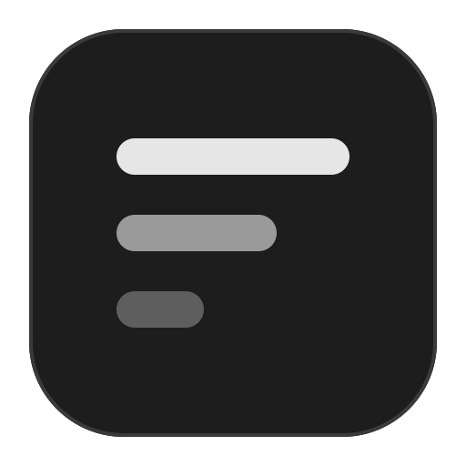
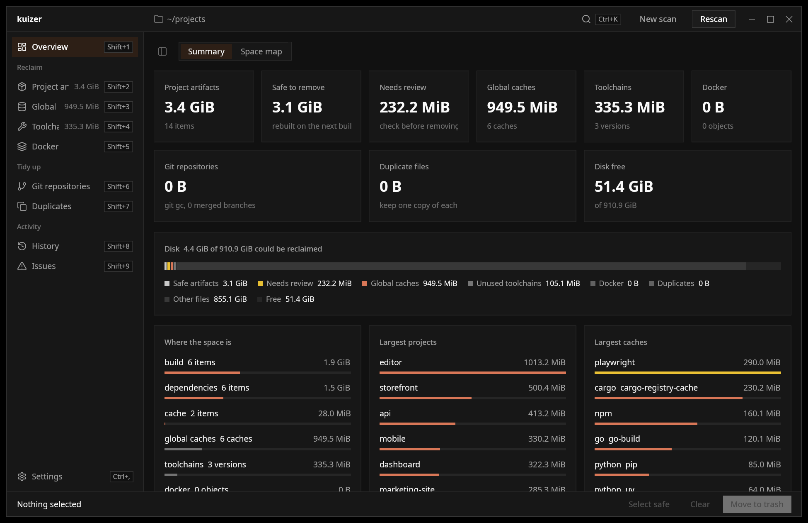
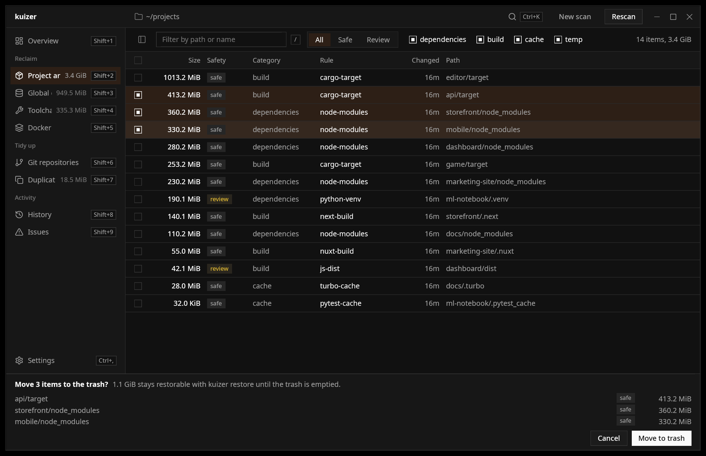
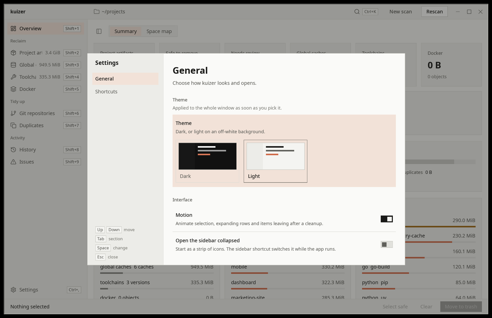

<p align="center">
  
</p>

<h1 align="center">kuizer</h1>

A disk cleanup tool for developers, written in Rust. It finds `node_modules`, Cargo `target` directories, build output, tool caches and duplicate files under your projects, and deletes the ones you select.

Website and documentation: [kuizer.app](https://kuizer.app), [kuizer.app/docs](https://kuizer.app/docs).

<p align="center">
  
  
  
  
  
  
  
</p>

<p align="center">
  
</p>
<p align="center">
  <sub>The desktop app on Linux. The same scan runs in the terminal as <code>kuizer</code>.</sub>
</p>

kuizer walks your project folders and lists `node_modules`, `.next`, Cargo `target` directories and other generated folders with their sizes. Built-in rules cover JavaScript and its frameworks, Rust, Python, .NET, Maven, Gradle, Swift, CocoaPods, Dart and Flutter, Elixir, Zig, Haskell, CMake, Terraform and Unity; `kuizer rules` lists them. A scan on its own never deletes anything.

It ships as a terminal tool with an interactive list, and as a desktop app built on [GPUI](https://gpui.rs). Both run the same scan, the same checks and the same deletion, and share one config file and one history.

- **Each artifact is checked against its project.** A `dist` folder counts only next to a `package.json`, and a `target` folder only next to a `Cargo.toml` with Cargo's cache tag inside. Every result is marked `safe` or `review`.
- **Deletion goes to the trash and is checked twice.** Right before removal, kuizer confirms the item is the directory it scanned, not a symlink or mount point, inside a scanned root, and not your home or a system directory.
- **Profiles and secrets are never entered.** Chrome, Brave, Firefox, Edge and Electron apps such as Discord, Slack and VS Code, plus `~/.ssh`, `~/.gnupg`, the keyrings and global tool installs are skipped. Anything else in a hidden home folder is `review`, never `safe`.
- **Beyond project folders** it lists global caches (npm, pnpm, yarn, bun, cargo, pip, uv, Go, Gradle, Maven, Playwright and more), installed toolchain versions (rustup, nvm, fnm, volta, pyenv, uv, SDKMAN, Go), Docker and Podman leftovers, git repositories that `git gc` would shrink, and duplicate files by size and BLAKE3 hash.
- **Idle projects only, if you want.** `--idle 60d` keeps the dependencies of what you work on today; a project's activity is its newest source file or last commit, so a stray `npm install` does not count.
- **Every deletion is logged.** `kuizer history` lists past runs with ids like `s4`, and `kuizer restore s4` puts a run back from the trash without overwriting anything.
- **Reports stay on your machine.** `kuizer scan --report` writes one HTML file with a zoomable treemap, and `kuizer dashboard` one page with charts and drill-downs. Neither loads anything from the network.

Configuration lives in `~/.config/kuizer/config.toml`; every key is optional and [docs/config.example.toml](docs/config.example.toml) lists them all. A folder containing a `.kuizerignore` file is skipped with everything under it. kuizer was called sweep until October 2026 and still reads `.sweepignore` markers and `~/.sweep-history.json`. The design and module boundaries are in [docs/design.md](docs/design.md).

## Command line

```sh
kuizer                                     # interactive list of the current directory
kuizer ~/projects                          # interactive list of a folder, ? shows the keys
kuizer scan ~/projects --min-size 50MB     # print large artifacts
kuizer scan ~/projects --report            # open an interactive treemap report
kuizer dashboard ~/projects                # open a web overview of everything
kuizer clean ~/projects --dry-run          # show what clean would remove
kuizer clean ~/projects --idle 3mo         # remove safe items of projects untouched for three months
kuizer clean ~/projects --select all       # remove safe and review items, after a confirmation
kuizer cache --clean --select npm          # remove the npm cache
kuizer toolchain ~/projects --clean        # remove toolchain versions no project pins
kuizer docker --clean                      # remove dangling images, stopped containers and build cache
kuizer git ~/apps --gc --branches          # pack loose objects, delete merged branches
kuizer restore --last                      # put the last run back from the trash
kuizer duplicates ~/Downloads --verify     # duplicate files, compared byte by byte
kuizer --json scan ~/projects              # every command prints JSON with --json
```

Deletion is permanent: nothing goes to the trash. Every command shows what it will remove and asks first. A tool downloads a toolchain version again when needed, and a merged branch's commits stay in the default branch.

## Desktop app

`kuizer-gui` opens on a start screen. Type a folder, pick one with the system dialog, reopen one of the last eight, or scan your whole home folder. The same screen sets the scan options: which kinds of artifacts to list, the smallest item size, how deep to walk, and whether to measure global caches, toolchains and Docker, look for duplicates and stay on one file system. The scan streams results in as it runs, and Escape stops it and keeps what it found.

The sidebar lists the sections: Overview, Project artifacts, Global caches, Toolchains, Docker, Git repositories, Duplicates, History and Issues. Shift+1 to Shift+9 jump between them, and `m` opens the space map: the scanned folders and the global caches as tiles sized by what they hold. Enter or a click opens a folder and shows each item inside as its own tile; Backspace goes back.

<p align="center">
  
</p>

In a list, `j`/`k` or the arrow keys move the cursor, Space selects a row, Shift-click selects a range, and `/` filters by path or name. Enter, Delete or `d` deletes the selection for good after an inline confirmation that shows the item count, total size and how many items are marked `review`. Right-click a row, or press the Menu key or Shift+F10, to reveal it in the file manager, copy its path, delete only that item, or exclude it from every later scan.

Ctrl+K (Cmd+K on macOS) opens a command palette with every action, section and recent folder, and `?` lists all shortcuts. Settings sit in the sidebar footer and behind Ctrl+, (Cmd+,): a dark or light theme, motion on or off, how the sidebar opens and whether the section keys show. They write to the same config file the CLI reads. Ctrl+B collapses the sidebar to a strip of icons. Tab and Shift+Tab move a focus ring through every button, toggle and sidebar item, Enter or Space presses it and Esc goes back to the list.

<p align="center">
  
</p>

```sh
kuizer-gui                                         # open the start screen
kuizer-gui ~/projects                              # skip the start screen and scan this folder
```

## Install

Prebuilt binaries for Linux and macOS, on x86_64 and ARM, are attached to every [GitHub release](https://github.com/remcostoeten/kuizer/releases), as plain archives with a SHA-256 checksum next to the installers below. The `kuizer-gui` archive includes a `.desktop` entry and an icon for Linux menus.

### Installer script

Downloads the right binary, checks it and puts it in `~/.cargo/bin`.

```bash
curl -LsSf https://github.com/remcostoeten/kuizer/releases/latest/download/kuizer-installer.sh | sh
curl -LsSf https://github.com/remcostoeten/kuizer/releases/latest/download/kuizer-gui-installer.sh | sh
```

### npm

```bash
npx kuizer                                          # run the CLI without installing
npm install -g kuizer                               # or keep it installed
```

### cargo

```bash
cargo binstall kuizer                               # the prebuilt binary through cargo-binstall
cargo install kuizer                                # or build from crates.io
```

### From source

```bash
git clone https://github.com/remcostoeten/kuizer
cargo install --path kuizer
cargo install --path kuizer/crates/kuizer-gui
```

On Linux the desktop app needs the X11, Wayland, Vulkan and font development packages to build. On Arch: `libxkbcommon-x11 wayland vulkan-icd-loader fontconfig freetype2`. On Debian and Ubuntu: `libxkbcommon-x11-dev libwayland-dev libx11-xcb-dev libxcb1-dev libfontconfig-dev libfreetype-dev libvulkan-dev libasound2-dev`.

## Development

Requires Rust 1.88 or newer (edition 2024).

```sh
cargo test --workspace --all-targets -j 2 -- --test-threads=2   # unit and filesystem tests, in temp dirs only
cargo clippy --workspace --all-targets -- -D warnings            # lint, as CI runs it
cargo fmt --all --check                                          # formatting, as CI runs it
cargo deny check                                                 # advisories, licenses and duplicate crates
cargo run --release --example synth -- /tmp/kuizer-bench 200 100 # build a synthetic tree to scan
```

`./dev` is a keyboard menu for building, running and testing. To release, bump `version` under `[workspace.package]` in `Cargo.toml`, commit, and push a matching tag such as `v0.1.3`; the release workflow builds both binaries, packages them and publishes the GitHub release with the matching section of [CHANGELOG.md](CHANGELOG.md) as its notes. Contribution notes are in [CONTRIBUTING.md](.github/CONTRIBUTING.md) and the security policy in [SECURITY.md](.github/SECURITY.md).

<br/>

xxx,<br/>
[Remco Stoeten](https://remcostoeten.com)<br/>
<small>MIT</small>
