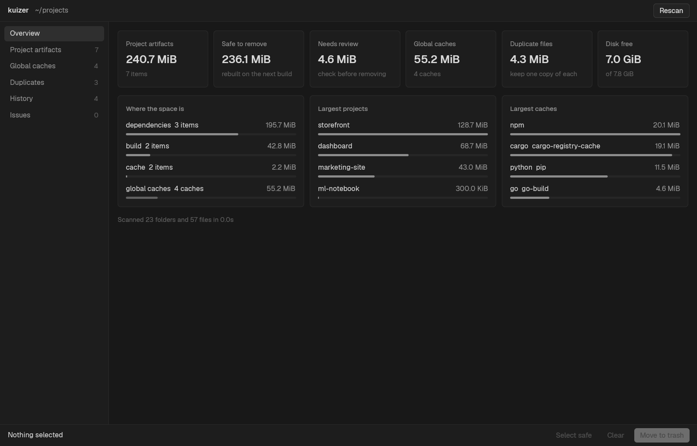

<h1 align="center">kuizer</h1>

A terminal tool that finds build output, development caches and duplicate files on a developer machine, and removes the ones you select.

<p align="center">
  
  
  
  
</p>

kuizer walks your project folders and lists `node_modules`, `.next`, Cargo `target` directories and other generated folders with their sizes. Built-in rules cover JavaScript and its frameworks, Rust, Python, .NET, Maven, Gradle, Swift, CocoaPods, Dart and Flutter, Elixir, Zig, Haskell, CMake, Terraform and Unity; `kuizer rules` lists them. You select what to remove in an interactive list or with `kuizer clean`. A scan on its own never deletes anything.

- **Each artifact is checked against its project.** A `dist` folder counts only next to a `package.json`, and a `target` folder only next to a `Cargo.toml` with Cargo's cache tag inside. Every result is marked `safe` or `review`.
- Deleted items go to the trash by default. Before each removal kuizer checks again that the item is the directory it scanned, not a symlink or mount point, inside a scanned root, and not your home directory or a system directory.
- Browser and app profiles are never entered or deleted: Chrome, Brave, Firefox, Edge and Electron apps such as Discord, Slack and VS Code. The same goes for `~/.ssh`, `~/.gnupg` and the keyrings, and for globally installed tools and editor extensions (`~/.vscode/extensions`, pnpm, bun and yarn global installs). Anything else found inside a hidden folder of your home directory is marked `review`, never `safe`.
- Projects with uncommitted git changes get a warning in the list and in the delete confirmation.
- `--idle 60d` keeps only projects you have not touched for that long, so the dependencies of what you work on today stay. A project's activity is its newest file outside generated folders or its last git commit, whichever is later; `npm install` or `cargo build` in an abandoned project does not make it active. `--sort idle` lists the longest idle first.
- Every deletion is logged to `~/.kuizer-history.json`. `kuizer history` lists past runs with ids like `s4`, shows what was freed and what is still in the trash, and `kuizer restore s4` puts a run back from the trash without overwriting anything.
- `kuizer scan --report` writes a single HTML file with a zoomable treemap of every result, grouped by project, category or rule, and opens it in your browser. The file loads nothing from the network.
- `kuizer dashboard` writes one HTML page with tabs for an overview with insights, project artifacts, a folder drill-down, global caches, duplicates and the deletion history with charts per week or month. Like the report, it loads nothing from the network.
- `kuizer cache` lists global caches for npm, pnpm, yarn, bun, deno, cargo, pip, uv, Go, Gradle, Maven, Playwright and others.
- `kuizer duplicates` finds files with identical contents by size and BLAKE3 hash. It never deletes them: you choose which copy to keep.

```sh
kuizer                                     # interactive list of the current directory
kuizer ~/projects                          # interactive list of a folder, ? shows the keys
kuizer scan ~/projects --min-size 50MB     # print large artifacts
kuizer scan ~/projects --report            # open an interactive treemap report
kuizer dashboard ~/projects                # open a web overview of everything
kuizer clean ~/projects --dry-run          # show what clean would remove
kuizer clean ~/projects --idle 3mo         # remove safe items of projects untouched for three months
kuizer clean ~/projects --select all       # remove safe and review items, after a confirmation
kuizer cache --clean --select npm          # remove the npm cache
kuizer restore --last                      # put the last run back from the trash
kuizer duplicates ~/Downloads --verify     # duplicate files, compared byte by byte
kuizer --json scan ~/projects              # every command prints JSON with --json
```

Configuration lives in `~/.config/kuizer/config.toml`; every key is optional. A directory containing a `.kuizerignore` file is skipped along with everything under it. kuizer was called sweep until October 2026 and still reads `.sweepignore` markers and `~/.sweep-history.json`. See [docs/config.example.toml](docs/config.example.toml) for the config keys, [docs/design.md](docs/design.md) for the design and roadmap, and [docs/kuizer-migration.md](docs/kuizer-migration.md) for the planned `kuizer code` dead-code command.

## Desktop app

`kuizer-gui` is a desktop window for the same scan, built on [GPUI](https://gpui.rs), the framework Zed is built on. It shows the dashboard's overview, project artifacts, global caches, duplicates, history and scan issues, and moves the items you select to the trash with the same checks as `kuizer clean`: a plain confirmation when everything is `safe`, and typing the item count when any item is `review`. Each cleanup lands in the history, so `kuizer history` and `kuizer restore` work on it. It never deletes permanently.

```sh
cargo run --release -p kuizer-gui -- ~/projects    # scan a folder; without a path it uses the config roots or your home directory
```



On Linux GPUI needs the X11, Wayland, Vulkan and font development packages. On Arch they come with `libxkbcommon-x11 wayland vulkan-icd-loader fontconfig freetype2`; on Debian and Ubuntu install `libxkbcommon-x11-dev libwayland-dev libx11-xcb-dev libxcb1-dev libfontconfig-dev libfreetype-dev libvulkan-dev libasound2-dev`.

## Install

Prebuilt binaries for Linux and macOS, on x86_64 and ARM, are attached to every [GitHub release](https://github.com/remcostoeten/kuizer/releases). The installer script downloads the right one, checks it and puts it in `~/.cargo/bin`:

```sh
curl -LsSf https://github.com/remcostoeten/kuizer/releases/latest/download/kuizer-installer.sh | sh
```

The desktop app installs the same way under its own name:

```sh
curl -LsSf https://github.com/remcostoeten/kuizer/releases/latest/download/kuizer-gui-installer.sh | sh
```

Each release also has plain archives with a SHA-256 checksum. The `kuizer-gui` archive includes a `.desktop` entry and an icon for Linux menus.

### From source

```sh
git clone https://github.com/remcostoeten/kuizer
cargo install --path kuizer
cargo install --path kuizer/crates/kuizer-gui
```

## Development

Requires Rust 1.88 or newer (edition 2024).

```sh
cargo test                                          # unit and filesystem tests in temp dirs
cargo test -p kuizer-gui                            # desktop app tests
cargo clippy --all-targets -- -D warnings           # lint, as CI runs it
cargo fmt --check                                   # formatting, as CI runs it
cargo deny check                                    # advisories, licenses and duplicate crates
dist plan                                           # list what a release builds, see dist-workspace.toml
cargo run --release --example synth -- /tmp/kuizer-bench 200 100   # build a synthetic tree to scan
```

To release, bump `version` under `[workspace.package]` in `Cargo.toml`, commit, and push a matching tag such as `v0.1.0`. The release workflow builds both binaries, packages them and publishes the GitHub release.

<br/>

xxx,<br/>
[Remco Stoeten](https://remcostoeten.com)<br/>
<small>MIT</small>
